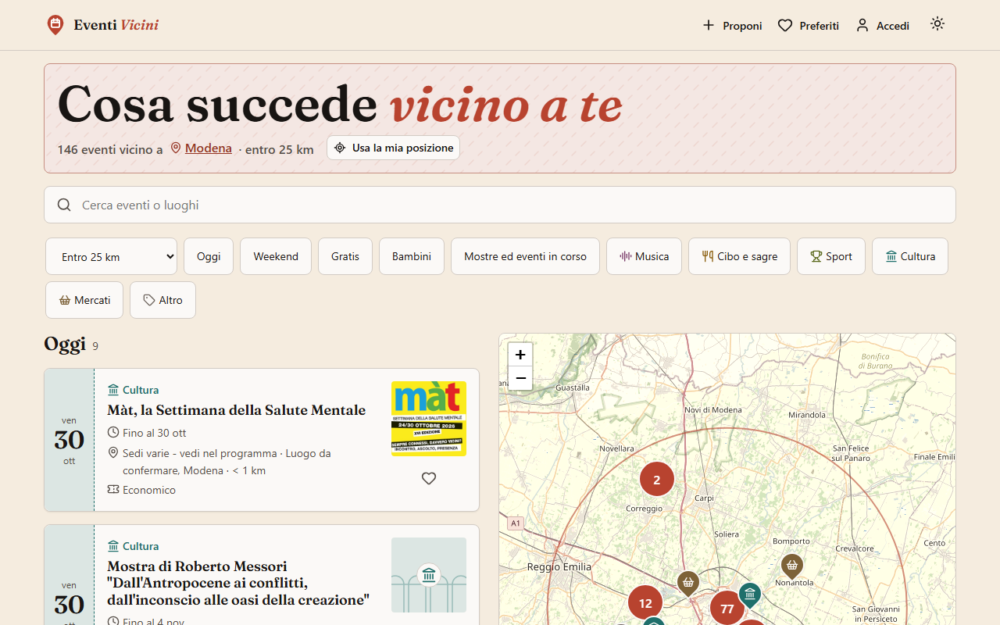
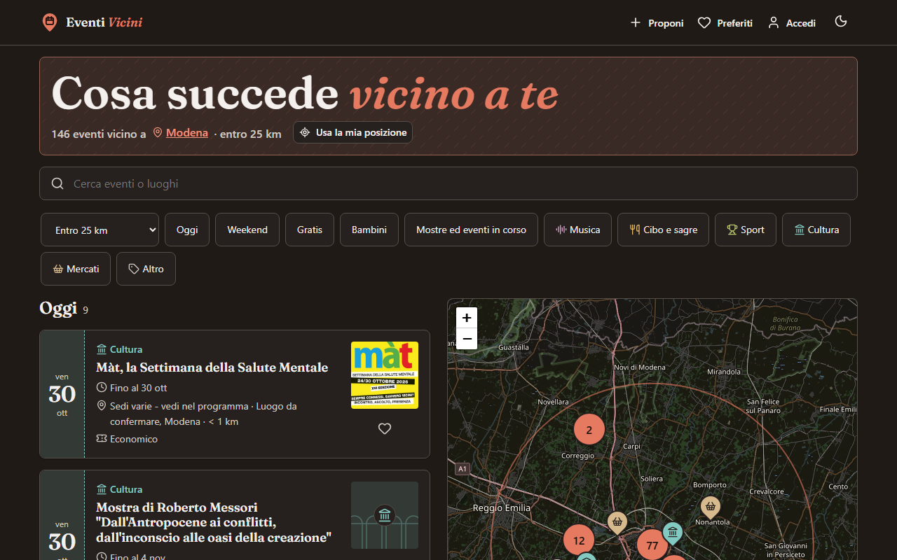
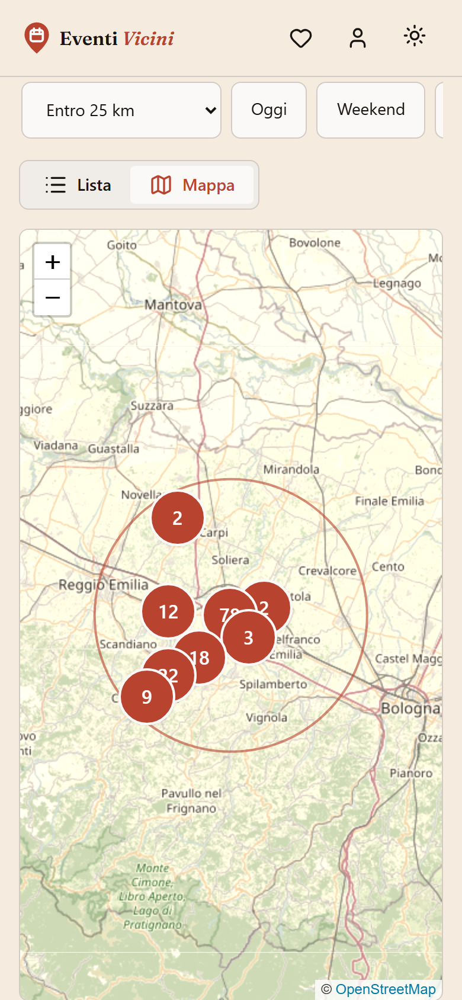
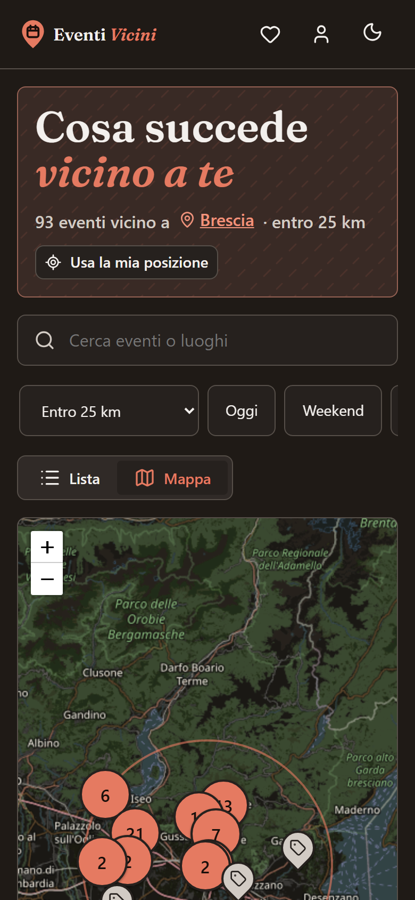
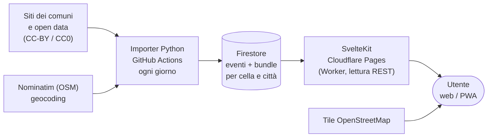

<p align="center">
  <picture>
    <source media="(prefers-color-scheme: dark)" srcset="docs/brand/logo-orizzontale-scuro.svg">
    
  </picture>
</p>

<p align="center"><b>L'agenda degli eventi pubblici vicino a te</b></p>

<p align="center">
  <a href="https://github.com/AndreaAzzarello/EventiVicini/actions/workflows/ci.yml"></a>
  <a href="https://eventi-vicini.pages.dev"></a>
  <a href="LICENSE"></a>
</p>

<p align="center"><a href="https://eventi-vicini.pages.dev"><b>→ Apri Eventi Vicini</b></a></p>

Eventi Vicini è un'agenda **gratuita** degli eventi pubblici italiani: sagre, mostre, concerti, mercati, attività per bambini. Mostra cosa succede oggi, stasera e nel fine settimana nel tuo comune e intorno a te, in lista o su mappa. È pensata per chi cerca qualcosa da fare senza account, senza pubblicità e senza tracciamento. Gli eventi arrivano dai siti istituzionali dei comuni e dagli open data, **ogni evento rimanda alla sua fonte**, e il progetto non costa nulla da mantenere (Firebase Spark, Cloudflare Pages gratuito).

*In English: Eventi Vicini is a free agenda of public events across Italy (festivals, exhibitions, concerts, markets, kids' activities). It collects events daily from municipal websites and open data that allow reuse (CC-BY/CC0), shows them as a list or on a map, has no ads and no tracking, and always links back to the original source. SvelteKit on Cloudflare Pages, Firebase Firestore, a Python importer on GitHub Actions. Code under MIT; event data stays under each source's license.*

**Indice:** [Screenshot](#screenshot) · [Funzioni](#funzioni) · [Come funziona](#come-funziona) · [Copertura](#copertura) · [Privacy](#privacy) · [Sviluppo](#sviluppo) · [Struttura](#struttura) · [Limiti noti](#limiti-noti) · [Sicurezza](#sicurezza) · [Crediti](#crediti) · [Licenza](#licenza)

<a id="screenshot"></a>
## Screenshot

Dati reali dal sito, Brescia, 30 ottobre 2026.

| Tema chiaro | Tema scuro |
|---|---|
|  |  |
|   |   |

<sub>Immagine del dettaglio evento: Comune di Brescia, [CC-BY 4.0](https://creativecommons.org/licenses/by/4.0/deed.it), licenza dichiarata nelle [note legali](https://www.comune.brescia.it/it/legal_notices) del sito · [fonte](https://www.comune.brescia.it/it/eventi/la-vittoria-di-brescia-2517862-2517870-2518098-2518288-2518464-2518595-2518756-2518996-2519319-2519486-2519746-2520013).</sub>

<a id="funzioni"></a>
## Funzioni

- **Lista per tempo**: Oggi, Stasera, Prossimi giorni, Questo weekend, Più avanti, In corso (mostre e rassegne lunghe).
- **Mappa** con pin per categoria, cluster e anteprima al tocco; lista e mappa sincronizzate.
- **Ricerca unificata** di eventi e luoghi (tutti i circa 7.900 comuni italiani, anche senza eventi, con nomi bilingui e omonimi distinti dalla sigla), con il luogo nell'URL (link condivisibili) e filtri rapidi per categoria.
- **Pagine per comune e per regione**, bilingue dove serve (Bolzano / Bozen).
- **Preferiti e proposte** con account facoltativo (Google o link via email): puoi proporre un evento, che viene approvato prima di apparire.
- **PWA installabile**, con pagina offline, tema chiaro e scuro, design system sobrio con carta calda e accento terracotta ([`DESIGN.md`](DESIGN.md)).
- **Fonti sempre citate**: ogni evento ha il link alla pagina originale.

<a id="come-funziona"></a>
## Come funziona



1. L'**importer** (`tools/importer/`) legge ogni giorno le fonti attive con un adapter per CMS (Plone, WordPress e HTML Design Comuni Italia, Open Data Hub Alto Adige; con la chiave `TICKETMASTER_API_KEY` anche Ticketmaster), normalizza, geocodifica, deduplica e scrive su Firestore **solo i documenti cambiati** (`contentHash`).
2. A fine import scrive i **bundle**: liste precalcolate per cella geografica e per città, così la webapp legge poche decine di documenti invece di fare una query per visita.
3. La **webapp** (`web/`) fa SSR su un Worker Cloudflare, legge Firestore via REST (niente Admin SDK) e usa cache a due livelli. Il Firebase SDK nel browser si carica solo per login, preferiti e proposte.

Dettagli: [architettura](docs/architettura.md) · [importer](docs/importer.md) · [quote e letture Firestore](docs/quote-firestore.md).

<a id="copertura"></a>
## Copertura

Dal registro delle fonti, stato al **29 ottobre 2026**: **20 regioni**, circa **7.900 comuni** censiti (ISTAT / IndicePA), **921 con una fonte attiva** (802 Design Comuni HTML, 112 WordPress, 6 Plone, 1 Open Data Hub). Il dry-run di fine ottobre contava circa **4.000 eventi** su un orizzonte di 45-60 giorni; i numeri variano con la stagione (a ottobre molti comuni del Sud pubblicano pochi eventi).

| Regione | Comuni | Fonti attive | | Regione | Comuni | Fonti attive |
|---|---:|---:|---|---|---:|---:|
| Lombardia | 1.502 | 255 | | Liguria | 234 | 16 |
| Veneto | 560 | 157 | | Friuli-V. Giulia | 215 | 12 |
| Piemonte | 1.180 | 111 | | Lazio | 378 | 19 |
| Emilia-Romagna | 330 | 66 | | Sardegna | 377 | 27 |
| Trentino-Alto Adige | 282 | 86 | | Sicilia | 391 | 19 |
| Toscana | 273 | 54 | | Campania | 550 | 13 |
| Marche | 225 | 25 | | Calabria | 404 | 10 |
| Valle d'Aosta | 74 | 13 | | Abruzzo | 305 | 10 |
| Umbria | 92 | 11 | | Puglia | 257 | 9 |
| Basilicata | 131 | 6 | | Molise | 136 | 2 |

Fonti: `tools/importer/sources/*.csv` (conteggio delle righe `attivo`) e i report in [`tools/importer/reports/`](tools/importer/reports/).

**Come si scelgono le fonti.** Una fonte diventa attiva solo se: esiste un adapter per il suo CMS; la licenza dei **contenuti** è CC0 o CC-BY (mai NC, ND, SA, «tutti i diritti riservati» sui contenuti); il `robots.txt` consente i percorsi usati; un dry-run produce almeno un evento futuro valido con coordinate coerenti. Il resto resta `da_verificare` o `escluso`, con il motivo in `note`. L'importer fa una richiesta al secondo per sito, con User-Agent identificativo, e ogni evento mostra e linka la fonte. Procedura completa in [docs/importer.md](docs/importer.md). Per proporre un comune: [CONTRIBUTING.md](CONTRIBUTING.md#proporre-una-nuova-fonte-comunale).

<a id="privacy"></a>
## Privacy

Nessun analytics, nessun pixel, nessun cookie di profilazione, nessun banner. Preferiti, posizione e tema stanno nel `localStorage` del dispositivo; l'account è facoltativo (età minima 14 anni). La posizione, se la concedi, non finisce nell'URL né nel profilo. Dettagli nella pagina [/privacy](https://eventi-vicini.pages.dev/privacy).

<a id="sviluppo"></a>
## Sviluppo

Requisiti: Node.js 24 (`.nvmrc`), JDK 21 per gli emulatori Firebase, Python 3.12 per l'importer.

```powershell
cd web; npm install
cd ..\firebase; npm install

cd ..\web
npm run emulators   # Auth + Firestore (resta aperto, Ctrl+C per chiudere)
npm run seed        # dati di prova, in un altro terminale
npm run dev         # sviluppo con hot reload
```

```powershell
npm run check; npm run lint; npm test; npm run build   # da web/
npm run test:e2e                                       # da web/: emulators:exec + Playwright
npm test                                               # da firebase/: test delle regole
python -m pytest -q tests                              # da tools/importer/
python run.py --dry-run --regione veneto               # importer, senza scrivere
```

Guide complete: [sviluppo, test e deploy](docs/sviluppo.md) · [importer](docs/importer.md) · [architettura e Firebase](docs/architettura.md) · [design system](DESIGN.md).

<a id="struttura"></a>
## Struttura

| Cartella | Contenuto |
|---|---|
| `web/` | Webapp SvelteKit (`adapter-cloudflare`), test Vitest e Playwright |
| `firebase/` | Regole e indici Firestore, test delle regole |
| `tools/importer/` | Importer Python, adapter, registro fonti (`sources/*.csv`), report |
| `.github/workflows/` | CI, import giornaliero, ricontrollo settimanale delle fonti |
| `docs/` | Documentazione tecnica, brand kit, screenshot |

<a id="limiti-noti"></a>
## Limiti noti

- Le liste vengono da bundle aggiornati una volta al giorno: un evento inserito o approvato dall'admin appare entro 24 ore.
- Le tile pubbliche di OpenStreetMap non sono adatte a traffico intenso; con molto traffico serve un altro provider.
- Cache e rate limit verso Nominatim valgono per isolate del Worker, non globalmente.
- Nessun adapter per Drupal, Joomla, Halley, Maggioli: quei comuni restano `da_verificare`.
- La ricerca testuale non guarda la descrizione degli eventi.

Elenco completo in [docs/importer.md](docs/importer.md) e [docs/quote-firestore.md](docs/quote-firestore.md).

<a id="sicurezza"></a>
## Sicurezza

Le regole Firestore sono testate (`firebase/test/`): `events` in lettura pubblica e scrittura solo admin, proposte validate, `users` solo del proprietario. Le chiavi web di Firebase sono pubbliche per costruzione; il service account dell'importer è un segreto di GitHub Actions. Per segnalare una vulnerabilità leggi [SECURITY.md](SECURITY.md).

<a id="crediti"></a>
## Crediti

- Dati degli eventi: siti istituzionali dei comuni, [Open Data Hub Alto Adige](https://opendatahub.com/) e, per concerti e spettacoli, la [Discovery API di Ticketmaster](https://developer.ticketmaster.com/) (senza affiliazione); elenco dei comuni [ISTAT](https://www.istat.it/note-legali/) (CC BY 4.0), coordinate e popolazione dei comuni da [Wikidata](https://www.wikidata.org/) (CC0) e siti da [IndicePA](https://indicepa.gov.it/) (CC-BY 4.0).
- Mappe e geocoding: © collaboratori di [OpenStreetMap](https://www.openstreetmap.org/copyright) (ODbL), [Leaflet](https://leafletjs.com/), [Nominatim](https://nominatim.org/).
- Icone: [Lucide](https://lucide.dev/) (ISC). Titoli: [Fraunces](https://github.com/undercasetype/Fraunces) (SIL OFL).
- Cronologia delle versioni: [CHANGELOG.md](CHANGELOG.md).

<a id="licenza"></a>
## Licenza

Il codice è rilasciato con [licenza MIT](LICENSE) © 2026 Andrea Azzarello. **I dati degli eventi non sono coperti dalla licenza del codice**: restano sotto le licenze delle rispettive fonti (CC-BY, CC0) e vanno citati. Nome, logo e immagini in [`docs/brand`](docs/brand/README.md) appartengono al progetto e non sono coperti dalla MIT.
